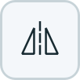

# PicView

An image folder viewer built with Qt, focused on **fast loading** and **image comparison**.

[繁體中文](https://github.com/codemee/picview/blob/main/README.md)

## Highlights

### Fast loading

- Load the current image and prioritize visible thumbnails while the rest load progressively in the background, reducing the wait when opening a folder.
- Keep thumbnails in memory for reuse across tabs and layout changes, avoiding repeated decoding without saving thumbnail files to disk.

### Image comparison

- Drag a tab or thumbnail onto the image pane to compare images across folders or within the same folder.
- Select images, zoom, rotate, mirror, and scroll each comparison pane independently to inspect details and differences.

## Install and run

### Desktop downloads

- Download desktop builds from [GitHub Releases](https://github.com/codemee/picview/releases) when attached to a release. Python and uv are not required.
- **Windows x64**: extract `PicView-<version>-windows-x64.zip`, keep the entire **PicView** folder, and run `PicView.exe` inside it. Close the app before replacing the whole folder for an update. If you move the folder, re-enable File Explorer context-menu integration.
- The folder build avoids extraction on every launch. When PicView is already open, file-open requests are forwarded before loading the full interface. See the [same-machine startup measurements](docs/STARTUP_PERFORMANCE.md).
- **macOS Apple Silicon**: open `PicView-<version>-macos-arm64.dmg`, then drag **PicView.app** into **Applications**.
- Desktop builds currently have no Windows publisher signature or Apple Developer ID notarization, so the operating system may prompt or block the first launch.

### With uv

- Requires [uv](https://docs.astral.sh/uv/getting-started/installation/) and a graphical desktop. PicView is developed and tested on Windows.
- Run without a permanent tool installation:

  ```powershell
  uvx picview
  ```

- Install as a command-line tool, then launch:

  ```powershell
  uv tool install picview
  picview
  ```

- Upgrade an installed copy:

  ```powershell
  uv tool upgrade picview
  ```

- Check the version:

  ```powershell
  picview --version
  # Or without installing:
  uvx picview --version
  ```

## Run from source

From the project directory, run:

```powershell
uv run picview
```

When launched through Python/uv on macOS, the Dock uses the PicView icon, but the application menu may still be named Python. Use the desktop `PicView.app` for the full application name and icon.

## Usage

### Window and toolbars

- Resize the window down to **260 × 220 px**.
- The main toolbar occupies its own row: open and sorting for the active tab on the left; date display, File Explorer/Finder integration, language, and theme on the right.
- Drag the dotted handle to the left of the thumbnail tabs or the image toolbar to a top, bottom, left, or right window edge to arrange the panes and choose their order. Drag the divider to resize them. The pane layout is shared across tabs and stays fixed when switching tabs.
- Folder tabs sit inside the thumbnail pane, sharing a row with the thumbnail tools on the right. The tab strip follows the active thumbnail pane.
- When tabs overflow, scroll arrows appear at opposite ends of the tab bar. Both scroll arrows and the tab-list dropdown use thin chevrons.
- Fit and full screen sit on the right, before the zoom value and slider. The shared comparison toolbar uses the same order.
- Hover over buttons or zoom controls to see their assigned keyboard shortcuts. The overflow menu also shows the corresponding keys.
- Thumbnail cards use distinct backgrounds and thin borders in both light and dark themes, keeping their boundaries visible while scrolling.
- Toggle tools such as sync and fit-to-pane use a background to indicate their active state. Icons keep their original color and stroke width; the background deepens on hover.
- The slider handles, active tab underline, and selected comparison pane border share the theme accent color.
- Tools that no longer fit move into <picture><source media="(prefers-color-scheme: dark)" srcset="https://raw.githubusercontent.com/codemee/picview/main/docs/icons/more-dark.png"></picture> on the main, thumbnail, and image toolbars.
- Widen the window to restore the hidden tools automatically.
- Visible thumbnails load first; the rest are decoded progressively in the background.
- Thumbnails use a shared memory cache (up to 64 MiB), with no thumbnail files saved to disk.
- Resizing panes rearranges existing thumbnails without decoding every image again.
- When sliders are hidden, use the overflow menu to enter zoom or thumbnail-size values.
- The window title shows the current version, for example **PicView v0.1.10**.

### Open and drag images

- The main toolbar's right-side “…” menu contains Explorer/Finder integration, language, and theme controls.

- The folder picker starts in the active tab's parent folder, or the folder itself when it has no parent.
- Use <kbd>Ctrl</kbd>-click to toggle individual thumbnails, <kbd>Shift</kbd>-click or <kbd>Shift</kbd>+arrow keys to select a range, or <kbd>Ctrl</kbd>+<kbd>A</kbd> to select all. Use <kbd>Command</kbd> instead of <kbd>Ctrl</kbd> on macOS. Drag across empty thumbnail space to select an area, or click empty space to clear the selection.
- Drag multiple selected images to another folder tab, or onto an image pane to compare them together.
- Cross-tab drops copy or move files according to the operating system's drag action. Name collisions prompt to replace, keep both, skip, or cancel. Tabs for the same folder simply select the image.
- After hovering to activate a tab, drop into its thumbnail area to move files. Hold <kbd>Ctrl</kbd> on Windows/Linux or <kbd>Option</kbd> on macOS to copy instead.

- Click <picture><source media="(prefers-color-scheme: dark)" srcset="https://raw.githubusercontent.com/codemee/picview/main/docs/icons/folder-dark.png"></picture> to choose a folder to view.
- Drop a folder or image file onto the window to open it.
- A newly opened folder tab inherits the current pane order and split ratio. Dragging a pane or divider updates the layout shared by all tabs.
- Drag a thumbnail or its filename to send the original file to another application that accepts file drops.
- Rotation and mirroring only affect the view; they do not modify image files.

### File Explorer and Finder context menus

- Click <picture><source media="(prefers-color-scheme: dark)" srcset="https://raw.githubusercontent.com/codemee/picview/main/docs/icons/shell-integration-dark.png"></picture> in the main toolbar settings menu to toggle the Windows File Explorer command or macOS Finder Services command. It is off by default; the active button uses the accent color.
- **Windows:** Right-click a folder, a folder background, or a supported image and choose **Open in PicView**. On Windows 11, the command may be under **Show more options**. It registers only for the current user and does not change the default image viewer.

macOS provides two separate ways to open items. Both require the packaged `PicView.app` in Applications:

| Method | Finder context-menu location | Supported items | How to enable |
| --- | --- | --- | --- |
| Open With | **Open With → PicView** | Supported images: JPEG, PNG, WebP, BMP, GIF, TIFF, SVG | Install and launch the App once for macOS to register it; the toolbar integration toggle is not required |
| Finder Services | **Services → Open in PicView** | Folders and supported images | Turn on the toolbar’s Finder integration toggle to install the service for the current user |

- Turning off Finder integration removes only the Services command. PicView remains in the image’s Open With list.
- Registering these commands does not make PicView the default image viewer. You can also drop images onto its Dock icon.
- Running through Python/uv cannot register the App’s Open With entry or install its bundled Finder service.
- Opening an image selects it in its containing folder; opening a folder views that folder. You can also run `picview "<folder-or-image-path>"` from a terminal.
- When PicView is already running, a context-menu or command-line path opens in that window as a new tab. Otherwise, PicView starts a new window.

### Image and pane tools

| Button | Action |
| --- | --- |
| <picture><source media="(prefers-color-scheme: dark)" srcset="https://raw.githubusercontent.com/codemee/picview/main/docs/icons/rotate-dark.png"></picture> | Rotate the current image |
| <picture><source media="(prefers-color-scheme: dark)" srcset="https://raw.githubusercontent.com/codemee/picview/main/docs/icons/mirror-h-dark.png"></picture> | Mirror the current image horizontally |
| <picture><source media="(prefers-color-scheme: dark)" srcset="https://raw.githubusercontent.com/codemee/picview/main/docs/icons/mirror-v-dark.png"></picture> | Mirror the current image vertically |
| <picture><source media="(prefers-color-scheme: dark)" srcset="https://raw.githubusercontent.com/codemee/picview/main/docs/icons/fit-dark.png"></picture> | Toggle fitted and original image size |
| <picture><source media="(prefers-color-scheme: dark)" srcset="https://raw.githubusercontent.com/codemee/picview/main/docs/icons/expand-dark.png"></picture> | Maximize the thumbnail or image pane |
| <picture><source media="(prefers-color-scheme: dark)" srcset="https://raw.githubusercontent.com/codemee/picview/main/docs/icons/shrink-dark.png"></picture> | Restore the pane layout |
| <picture><source media="(prefers-color-scheme: dark)" srcset="https://raw.githubusercontent.com/codemee/picview/main/docs/icons/fullscreen-dark.png"></picture> | Open the current image in full screen |

### Thumbnail sorting, dates, and file actions

- The sort-method button in the main toolbar toggles between <picture><source media="(prefers-color-scheme: dark)" srcset="https://raw.githubusercontent.com/codemee/picview/main/docs/icons/sort-name-dark.png"></picture> **Name (natural order)** and <picture><source media="(prefers-color-scheme: dark)" srcset="https://raw.githubusercontent.com/codemee/picview/main/docs/icons/sort-date-dark.png"></picture> **Date modified** for the active tab only.
- The adjacent direction button toggles between <picture><source media="(prefers-color-scheme: dark)" srcset="https://raw.githubusercontent.com/codemee/picview/main/docs/icons/sort-ascending-dark.png"></picture> **ascending** and <picture><source media="(prefers-color-scheme: dark)" srcset="https://raw.githubusercontent.com/codemee/picview/main/docs/icons/sort-descending-dark.png"></picture> **descending**. Dates ascend from oldest to newest and descend from newest to oldest. Sorting preserves the selected image and its view settings.
- <picture><source media="(prefers-color-scheme: dark)" srcset="https://raw.githubusercontent.com/codemee/picview/main/docs/icons/modified-visible-dark.png"></picture> on the right side of the main toolbar toggles **Show date modified** for all tabs. This global preference survives restarting and applies to new and duplicated tabs.
- Cards show the local modification date and time at the bottom by default; hover over a truncated date to see the full timestamp.
- Each tab remembers its sort method and direction when duplicated or restored after restarting. New or modified files update their order and timestamps automatically.
- Right-click a thumbnail card and choose **Copy** to copy the original file to the clipboard for pasting into another application or folder.
- **Properties** opens the native Explorer property sheet on Windows. On other platforms, or if the system dialog cannot open, it shows the file name, type, location, size, modification time, image dimensions, and creation time when available.
- When the main toolbar is narrow, use **⋯ More tools** to operate the sorting and date-display buttons.

### Supported formats

- Raster images: JPEG, PNG, WebP, BMP, GIF, and TIFF.
- Vector images: static SVG.
- SVG preserves transparency and renders again at the display resolution when zooming.
- SVG supports comparison, rotation, mirroring, and full screen.
- SVG animations currently appear as static images.

### Folder monitoring and automatic updates

- All open folders are monitored for file changes automatically.
- New files appear in the thumbnail pane without changing the current image.
- Modified files refresh their thumbnails, image panes, and full-screen views.
- Updates preserve zoom, rotation, mirroring, and scroll positions.
- The last complete image remains visible while a file is still being written.
- Deleting the current image shows a notification at the bottom and selects the next image in order.
- Deleting the last image wraps to the first; an empty folder clears the image pane.
- A **●** marks a background tab's deletion notification; switch back to read it.
- Animations pause in background tabs.

### Multiple folder tabs

- Click <picture><source media="(prefers-color-scheme: dark)" srcset="https://raw.githubusercontent.com/codemee/picview/main/docs/icons/folder-dark.png"></picture> in the main toolbar to open a folder in a new tab.
- <picture><source media="(prefers-color-scheme: dark)" srcset="https://raw.githubusercontent.com/codemee/picview/main/docs/icons/tab-list-dark.png"></picture> at the far right of the tab strip opens a dropdown of all tabs in their current order. Select an entry to switch directly to that tab; a checkmark identifies the current tab.
- The list shows full tab names. Hover over an entry to see the folder's full path.
- Drop multiple folders to open a tab for each one.
- Open the same folder in multiple tabs to select and compare different images independently.
- Right-click a tab → **Duplicate tab** to create a copy beside it.
- The copy preserves the original tab's image selection and view settings.
- In comparison mode, duplicating a participating tab also adds the copy to comparison.
- Drag along the tab strip to reorder tabs; drag a tab downward onto the image pane to compare it.
- A tab switches on mouse release after a click. Dragging a tab keeps the currently displayed folder in view.
- Secondary tools collapse first when space is limited; excess tabs scroll horizontally and long names are shortened.
- The selected tab's underline stops before the scroll arrows and does not show beneath them, in both light and dark themes.
- Scroll arrows stay at opposite ends of the tab strip and use consistent thin chevrons, matching the dropdown arrow on the right.
- The current tab stays visible when opening tabs, switching tabs, or resizing the window.
- Use a tab's close button to close it; closing the last tab leaves an empty tab.
- Each tab keeps its own selection, zoom, rotation, mirroring, scrolling, thumbnail size, and pane layout.
- Language and theme are shared across all tabs.
- Restarting restores all tabs, their order, and the active tab.
- Missing folders keep their tabs and resume automatically when they return.
- See “Keyboard shortcuts” below for tab shortcuts.

### Compare images

- Drag a tab or thumbnail onto an image pane to keep that image and add the dragged image to a comparison.
- Drag onto any comparison pane to add more images in drop order. Space is shared equally; adding stops when the panes would become too small.
- Dropping multiple selected thumbnails adds each image to the comparison without adding visible folder tabs.
- Multiple-image drops skip images already shown in the comparison. Hover over another folder tab during a thumbnail drag to activate it.
- A translucent overlay and spinner indicate loading during a drop; raster images decode in the background.
- Hold a thumbnail drag over either tab scroll arrow to keep scrolling toward hidden tabs.
- Drag another thumbnail from a folder already in the comparison to add an independent image pane without adding a visible folder tab. Selecting these panes shows each image in the same folder tab's thumbnails.
- Hold and drag an image or pane title toward another comparison pane to reorder them. An image preview follows the pointer, a dashed placeholder marks its position, and other images shift to preview the order. Release in the first or second half to place it before or after that pane.
- When thumbnails and images are stacked, comparison images sit side by side. When thumbnails and images sit side by side, comparison images are stacked.
- Switching the selected comparison image or tab keeps the outer pane layout fixed. Leaving comparison keeps that layout across tabs.
- Full screen in comparison mode shows every compared image, with space around the screen edges and between panes. Images sit side by side on wide screens and stack on portrait screens. Each image initially fits without enlarging beyond its original size. The active image has an accent outline; click a pane or press <kbd>Tab</kbd> / <kbd>Shift</kbd>+<kbd>Tab</kbd> to switch. The toolbar also toggles synchronized operations.
- Switch to each tab and select its image from the thumbnails.
- Comparison panes share one toolbar above the images.
- The shared image toolbar has an End comparison button that closes comparison mode at once.
- Click an image pane to select it, show its corresponding tab and thumbnails, and target it with the shared toolbar; an accent-colored border marks the selection.
- Press <kbd>Tab</kbd> to cycle through comparison panes in order, or <kbd>Shift</kbd>+<kbd>Tab</kbd> to cycle backward.
- Leaving comparison activates the last folder in comparison order and keeps the current pane layout.
- Arrow keys, <kbd>Home</kbd>/<kbd>End</kbd>, <kbd>Page Up</kbd>/<kbd>Page Down</kbd>, <kbd>Space</kbd>, and <kbd>Backspace</kbd> navigate images in the selected pane's folder.
- By default, zoom, rotate, mirror, set the background, and scroll each pane independently.
- Click <picture><source media="(prefers-color-scheme: dark)" srcset="https://raw.githubusercontent.com/codemee/picview/main/docs/icons/sync-dark.png"></picture> in the image toolbar to apply rotation, mirroring, zoom, fit, background, and horizontal and vertical scrolling to every comparison pane. Images of different sizes align by scroll position as a proportion of their scrollable range. Click again to return to independent controls.
- Visible background images continue updating when files change.
- Click the close button in the upper-right corner of a comparison pane to remove that image. When one pane remains, normal viewing resumes with that image selected in the thumbnails.

### Zoom and thumbnail size

- Images that fit the pane open at their original size, **100%**.
- Larger images are scaled to fit the pane automatically.
- Click <picture><source media="(prefers-color-scheme: dark)" srcset="https://raw.githubusercontent.com/codemee/picview/main/docs/icons/fit-dark.png"></picture> to toggle between fitted and original size.
- Drag the zoom slider or press <kbd>+</kbd> / <kbd>-</kbd> to adjust the view.
- Press <kbd>0</kbd> to return to **100%**.
- Full screen initially scales oversized images down to fit; smaller images stay centered at their original size, with space around the screen edges. The floating toolbar provides rotation, mirroring, background color, fit, and zoom controls. Drag its left grip to move it out of the way; enlarged images can be scrolled.
- Leaving full screen preserves the pane's zoom, rotation, and mirroring settings.
- Click the value to the left of a slider to enter an exact zoom percentage or thumbnail size.
- In the value popup, press <kbd>Enter</kbd> to apply.
- Press <kbd>Esc</kbd> or click outside to cancel.
- Click reset to restore **100%** zoom or **140 px** thumbnails.

### Background colors for transparent images

- Click <picture><source media="(prefers-color-scheme: dark)" srcset="https://raw.githubusercontent.com/codemee/picview/main/docs/icons/background-dark.png"></picture> in the image toolbar to open the background color panel.
- Choose **Default (follow theme)** to use the current theme's image background.
- Choose white, black, gray, light gray, cream, light blue, light green, or light pink to make transparent image details easier to see.
- Dark gray, slate, dark blue, dark green, dark purple, dark red, dark brown, and dark teal backgrounds help inspect light-colored images.
- The 16 background colors appear in four columns of swatches, with color names in tooltips. The default option keeps its text and previews the current theme's default background color.
- The background applies immediately to image and full-screen views, without changing image files or thumbnail backgrounds.
- Tabs and comparison panes keep independent choices, preserved when duplicating tabs or restarting.
- When the toolbar is narrow, open the background panel from **⋯ More tools**.

### Keyboard shortcuts

| Action | Shortcut |
| --- | --- |
| Previous image | <kbd>Left</kbd>, <kbd>Page Up</kbd>, or <kbd>Backspace</kbd> |
| Next image | <kbd>Right</kbd>, <kbd>Page Down</kbd>, or <kbd>Space</kbd> |
| Thumbnail in previous / next row | <kbd>Up</kbd> / <kbd>Down</kbd> |
| First / last image | <kbd>Home</kbd> / <kbd>End</kbd> |
| Toggle fit to pane | <kbd>Alt</kbd>+<kbd>F</kbd> |
| Rotate clockwise | <kbd>Alt</kbd>+<kbd>C</kbd> |
| Mirror vertically / horizontally | <kbd>Alt</kbd>+<kbd>V</kbd> / <kbd>Alt</kbd>+<kbd>H</kbd> |
| Open full screen | <kbd>F11</kbd> |
| Close full screen | <kbd>Esc</kbd> |
| Open a folder | System Open shortcut |
| Open a folder in a new tab | <kbd>Ctrl</kbd>+<kbd>T</kbd> |
| Close the current tab | <kbd>Ctrl</kbd>+<kbd>W</kbd> |
| Next / previous tab (wrap around) | <kbd>Ctrl</kbd>+<kbd>Tab</kbd> / <kbd>Ctrl</kbd>+<kbd>Shift</kbd>+<kbd>Tab</kbd>, or <kbd>Ctrl</kbd>+<kbd>Page Down</kbd> / <kbd>Ctrl</kbd>+<kbd>Page Up</kbd> |
| Select tab 1–8 | <kbd>Ctrl</kbd>+<kbd>1</kbd>–<kbd>Ctrl</kbd>+<kbd>8</kbd> |
| Select the last tab | <kbd>Ctrl</kbd>+<kbd>9</kbd> |
| Reopen the last closed tab | <kbd>Ctrl</kbd>+<kbd>Shift</kbd>+<kbd>T</kbd> (restores position and view; remembers up to 20 tabs during this session) |
| Copy the selected image file to the clipboard | <kbd>Ctrl</kbd>+<kbd>C</kbd> (Windows / Linux), <kbd>Command</kbd>+<kbd>C</kbd> (macOS) |

- On macOS, use <kbd>Command</kbd> instead of <kbd>Ctrl</kbd> for new, close, numbered, and reopen tab shortcuts.
- Tab cycling also supports the platform defaults.

### Language

- Open the main toolbar settings menu and click the language item to cycle through **Follow system → Chinese → English**.
- The icons are <picture><source media="(prefers-color-scheme: dark)" srcset="https://raw.githubusercontent.com/codemee/picview/main/docs/icons/lang-system-dark.png"></picture> → <picture><source media="(prefers-color-scheme: dark)" srcset="https://raw.githubusercontent.com/codemee/picview/main/docs/icons/lang-zh-dark.png"></picture> → <picture><source media="(prefers-color-scheme: dark)" srcset="https://raw.githubusercontent.com/codemee/picview/main/docs/icons/lang-en-dark.png"></picture>.
- The default is **Follow system**: Chinese for Chinese locales and English otherwise.
- Your language choice is remembered across restarts.

### Theme

- Open the main toolbar settings menu and click the theme item to cycle through **Follow system → Light → Dark**.
- The icons are <picture><source media="(prefers-color-scheme: dark)" srcset="https://raw.githubusercontent.com/codemee/picview/main/docs/icons/theme-system-dark.png"></picture> → <picture><source media="(prefers-color-scheme: dark)" srcset="https://raw.githubusercontent.com/codemee/picview/main/docs/icons/theme-light-dark.png"></picture> → <picture><source media="(prefers-color-scheme: dark)" srcset="https://raw.githubusercontent.com/codemee/picview/main/docs/icons/theme-dark-dark.png"></picture>.
- The default is **Follow system**.
- The dark theme uses a Unit-01-inspired palette: deep purple surfaces, neon green indicators and sliders, and orange tool accents.
- Switching themes updates visible thumbnail cards first. Other cards update when scrolled into view or when their tab becomes active.
- Image colors remain unchanged.

## License

PicView is licensed under the **GNU General Public License, version 3 or later** (`GPL-3.0-or-later`). See [LICENSE](https://github.com/codemee/picview/blob/main/LICENSE) for the full terms.

- On Windows, click the application icon at the left of the title bar, or press <kbd>Alt</kbd>+<kbd>Space</kbd>, then choose **About PicView** from the system menu.
- On macOS, choose **PicView → About PicView** from the application menu at the top of the screen.
- About shows the current version, full license text, and project/download links. It also lists the Qt version and current interface style to help identify appearance differences between runtime environments.
