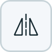

# PicView

專注於**快速載圖**與**多圖比較**的圖片資料夾檢視器，使用 Qt 打造。

[English](https://github.com/codemee/picview/blob/main/README.en.md)

## 主要特色

### 快速載圖

- 優先載入目前圖片與可見範圍的縮圖，其餘縮圖在背景逐步補上，縮短開啟資料夾的等待時間。
- 縮圖保留於記憶體，切換標籤與調整版面時可重用，不必反覆解碼，也不另存縮圖檔案。

### 多圖比較

- 將標籤或縮圖拖到單圖窗格即可開始比圖，支援不同資料夾，也能在同一資料夾比較不同圖片。
- 每個比圖窗格可各自選圖、縮放、旋轉、鏡射與捲動，方便檢查細節與差異。

## 安裝與啟動

### 桌面版下載

- Windows 使用固定的 PicView 工作列識別碼與多尺寸圖示。更新後若已釘選的捷徑仍顯示舊圖示，取消釘選後從新版 PicView 視窗重新釘選即可更新該項目。

- 已附加桌面版的版本可從 [GitHub Releases](https://github.com/codemee/picview/releases) 下載，不需要安裝 Python 或 uv。
- **Windows x64**：解壓 `PicView-<版本>-windows-x64.zip`，保留整個 **PicView** 資料夾，再執行其中的 `PicView.exe`。更新時先關閉程式，替換整個資料夾；若曾啟用檔案總管右鍵整合，搬移資料夾後須重新啟用。
- 資料夾版避免每次啟動時重複解壓；已有 PicView 視窗時，開檔要求會在載入完整介面前交給該視窗。[同機啟動量測與方法](docs/STARTUP_PERFORMANCE.md)。
- **macOS Apple Silicon**：開啟 `PicView-<版本>-macos-arm64.dmg`，將 **PicView.app** 拖曳到 **Applications**。
- 桌面版目前沒有 Windows 發行者簽章或 Apple Developer ID 公證，首次開啟時可能會出現系統提示或遭到阻擋。

### 使用 uv

- 需要先安裝 [uv](https://docs.astral.sh/uv/getting-started/installation/)，並在圖形桌面環境執行。PicView 目前於 Windows 開發與測試。
- 不永久安裝工具，直接執行：

  ```powershell
  uvx picview
  ```

- 安裝為命令列工具，再啟動：

  ```powershell
  uv tool install picview
  picview
  ```

- 更新已安裝的版本：

  ```powershell
  uv tool upgrade picview
  ```

- 查詢版本：

  ```powershell
  picview --version
  # 或不安裝直接查詢：
  uvx picview --version
  ```

## 從原始碼啟動

在專案目錄中執行：

```powershell
uv run picview
```

macOS 從 Python／uv 啟動時，Dock 使用 PicView 圖示，但選單列名稱仍可能顯示 Python；使用桌面版 `PicView.app` 可取得完整的應用程式名稱與圖示。

## 使用方式

### 視窗與工具列

- 視窗最小可縮至 **260 × 220 px**。
- 主工具列獨立一列：左側為開啟與目前標籤的排序工具，右側為修改時間顯示、檔案總管／Finder 整合、語言與配色工具。
- 拖曳縮圖窗格標籤列左側或單圖窗格工具列左側的點狀把手到視窗上、下、左、右邊緣，可調整兩窗格的排列與先後位置；拖曳分隔條可調整比例。窗格版面由所有標籤共用，切換標籤時不會改變。
- 資料夾標籤位於縮圖窗格內，與右側的縮圖工具共用一列；切換標籤時會跟隨目前的縮圖窗格。
- 標籤超出可見範圍時，左右捲動箭頭分別顯示於標籤列兩側；左右箭頭與標籤清單的向下箭頭採細線條樣式。
- 單圖窗格的符合窗格與全螢幕工具位於右側縮放比例與滑桿之前；比圖模式的共用工具列也採用相同排列。
- 將滑鼠停在按鈕或縮放控制上，可從提示查看已設定的快捷鍵；收合選單也會顯示對應按鍵。
- 淺色與深色配色的縮圖卡片皆採用獨立底色與細邊框，捲動時也能清楚辨識卡片邊界。
- 符合窗格、同步等狀態按鈕以底色表示啟用，圖示維持原本的顏色與線條粗細；滑鼠移入時底色會加深。
- 滑桿手把、目前標籤的底線，以及比圖作用中窗格的外框採用相同的主題強調色。
- 主工具列、縮圖與單圖工具列放不下的工具會收進 <picture><source media="(prefers-color-scheme: dark)" srcset="https://raw.githubusercontent.com/codemee/picview/main/docs/icons/more-dark.png"></picture>。
- 放寬視窗後，收起的工具會自動恢復。
- 縮圖會優先載入可見範圍，其餘在背景逐步製作。
- 縮圖使用共用的記憶體快取（上限 64 MiB），不另存縮圖檔案。
- 調整窗格大小只重新排列縮圖，不會重新解碼所有圖片。
- 滑桿收起時，可從更多工具選單輸入縮放比例或縮圖大小。
- 視窗標題會顯示目前版本，例如 **PicView v0.1.10**。

### 開啟與拖放圖片

- 主工具列右側的「…」選單提供檔案總管／Finder 整合、語言與配色設定。

- 開啟資料夾對話框預設顯示目前標籤資料夾的上一層；若沒有上一層，則顯示目前資料夾。
- 在縮圖上使用 <kbd>Ctrl</kbd> 點選切換個別選取、<kbd>Shift</kbd> 點選或 <kbd>Shift</kbd>+方向鍵選取連續範圍，或按 <kbd>Ctrl</kbd>+<kbd>A</kbd> 全選；macOS 以 <kbd>Command</kbd> 取代 <kbd>Ctrl</kbd>。也可在縮圖空白處拖曳框選，點擊空白處則取消選取。
- 可一次拖曳多張已選圖片到其他資料夾標籤，或拖到單圖／比圖窗格一次加入比圖。
- 跨標籤拖放依作業系統的拖曳動作複製或搬移檔案；遇到同名檔會詢問取代、保留兩者、略過或取消。同一資料夾的標籤之間則直接選取圖片。
- 拖曳切換標籤後，也可放進該標籤的縮圖區，預設搬移檔案；Windows／Linux 按住 <kbd>Ctrl</kbd>、macOS 按住 <kbd>Option</kbd> 則複製。

- 點擊 <picture><source media="(prefers-color-scheme: dark)" srcset="https://raw.githubusercontent.com/codemee/picview/main/docs/icons/folder-dark.png"></picture>，選擇要檢視的資料夾。
- 將資料夾或圖片檔案拖曳至視窗，也能開啟檢視。
- 新開啟的資料夾標籤沿用目前的窗格排列與比例；拖曳窗格或分隔條會同步調整所有標籤的版面。
- 按住縮圖或檔名拖曳，可將原始圖檔拖放至接受檔案的其他應用程式。
- 旋轉與鏡射只影響檢視畫面，不會修改圖檔。

### 檔案總管與 Finder 右鍵選單

- 點擊主工具列語系工具左側的 <picture><source media="(prefers-color-scheme: dark)" srcset="https://raw.githubusercontent.com/codemee/picview/main/docs/icons/shell-integration-dark.png"></picture>，直接開啟或關閉 Windows 檔案總管右鍵選單或 macOS Finder「服務」；預設關閉。啟用時按鈕會顯示強調色。
- **Windows**：在資料夾、資料夾空白處或支援的圖片檔上按右鍵，選擇「使用 PicView 開啟」。Windows 11 可能需要先選「顯示其他選項」。此設定只修改目前使用者的右鍵選單，不會變更預設開圖程式。

macOS 提供兩種不同的開啟方式，皆需使用放在 Applications 的封裝版 `PicView.app`：

| 方式 | Finder 右鍵選單位置 | 適用對象 | 如何啟用 |
| --- | --- | --- | --- |
| 打開檔案的應用程式 | 「打開檔案的應用程式 → PicView」 | 支援的圖檔：JPEG、PNG、WebP、BMP、GIF、TIFF、SVG | 安裝並開啟 App 一次，由 macOS 註冊；不需開啟工具列整合按鈕 |
| Finder 服務 | 「服務 → 使用 PicView 開啟」 | 資料夾與支援的圖檔 | 在 App 內開啟工具列的 Finder 整合按鈕，安裝目前使用者的服務 |

- 關閉 Finder 整合按鈕只會移除「服務」項目；PicView 仍會出現在圖檔的「打開檔案的應用程式」清單。
- 註冊以上項目不會將 PicView 設為預設開圖程式。圖檔也可拖到 PicView 的 Dock 圖示開啟。
- 從 Python／uv 啟動無法註冊 App 的「打開檔案的應用程式」項目，也無法安裝內附的 Finder 服務。
- 從圖片啟動時，PicView 會開啟該圖片所在資料夾並選取該圖片；從資料夾啟動時會直接檢視資料夾。也可用 `picview "<資料夾或圖片路徑>"` 從命令列開啟。
- 若已有 PicView 視窗，從右鍵選單或命令列開啟路徑會交給該視窗，在新標籤檢視；沒有執行中的視窗時才啟動新視窗。

### 圖片與窗格工具

| 按鈕 | 操作 |
| --- | --- |
| <picture><source media="(prefers-color-scheme: dark)" srcset="https://raw.githubusercontent.com/codemee/picview/main/docs/icons/rotate-dark.png"></picture> | 旋轉目前圖片 |
| <picture><source media="(prefers-color-scheme: dark)" srcset="https://raw.githubusercontent.com/codemee/picview/main/docs/icons/mirror-h-dark.png"></picture> | 水平鏡射目前圖片 |
| <picture><source media="(prefers-color-scheme: dark)" srcset="https://raw.githubusercontent.com/codemee/picview/main/docs/icons/mirror-v-dark.png"></picture> | 垂直鏡射目前圖片 |
| <picture><source media="(prefers-color-scheme: dark)" srcset="https://raw.githubusercontent.com/codemee/picview/main/docs/icons/fit-dark.png"></picture> | 切換符合窗格與原始大小 |
| <picture><source media="(prefers-color-scheme: dark)" srcset="https://raw.githubusercontent.com/codemee/picview/main/docs/icons/fullscreen-dark.png"></picture> | 開啟目前圖片的全螢幕檢視 |

### 縮圖排序、日期與檔案操作

- 主工具列的排序方式按鈕，在 <picture><source media="(prefers-color-scheme: dark)" srcset="https://raw.githubusercontent.com/codemee/picview/main/docs/icons/sort-name-dark.png"></picture> **檔名（自然排序）** 與 <picture><source media="(prefers-color-scheme: dark)" srcset="https://raw.githubusercontent.com/codemee/picview/main/docs/icons/sort-date-dark.png"></picture> **修改時間** 間切換，只影響目前標籤。
- 旁邊的排序方向按鈕，在 <picture><source media="(prefers-color-scheme: dark)" srcset="https://raw.githubusercontent.com/codemee/picview/main/docs/icons/sort-ascending-dark.png"></picture> **順向** 與 <picture><source media="(prefers-color-scheme: dark)" srcset="https://raw.githubusercontent.com/codemee/picview/main/docs/icons/sort-descending-dark.png"></picture> **逆向** 間切換；修改時間順向為舊到新，逆向為新到舊。排序不會切換目前圖片或重設檢視狀態。
- 主工具列右側的 <picture><source media="(prefers-color-scheme: dark)" srcset="https://raw.githubusercontent.com/codemee/picview/main/docs/icons/modified-visible-dark.png"></picture> 切換 **顯示修改日期時間**，立即套用到所有標籤，並保留至下次開啟程式；新開與複製標籤也沿用此全域設定。
- 縮圖卡片底部預設顯示本機時間的修改日期時間；卡片太窄時，將滑鼠停在日期上可查看完整時間。
- 各標籤獨立保存排序方式與方向，複製標籤及重開程式時也會保留。新增或修改檔案後，排序與日期會自動更新。
- 在縮圖卡片按滑鼠右鍵，選 **複製** 可將原始圖檔複製到剪貼簿，再貼至其他應用程式或資料夾。
- 右鍵選單的 **內容** 在 Windows 開啟檔案總管原生內容視窗；其他平台或系統視窗無法開啟時，顯示檔名、類型、位置、大小、修改時間、圖片尺寸，以及可取得的建立時間。
- 主工具列空間不足時，可從 **⋯ 更多工具** 操作排序與日期顯示按鈕。

### 支援格式

- 點陣圖片：JPEG、PNG、WebP、BMP、GIF、TIFF。
- 向量圖片：靜態 SVG。
- SVG 保留透明背景，縮放時會依顯示尺寸重新繪製。
- SVG 支援比圖、旋轉、鏡射及全螢幕。
- SVG 動畫目前以靜態畫面顯示。

### 資料夾監看與自動更新

- 所有已開啟的資料夾都會自動監看檔案變更。
- 新增圖檔：自動加入縮圖窗格，保留目前檢視的圖片。
- 修改圖檔：自動更新縮圖、單圖及全螢幕畫面。
- 更新時保留縮放、旋轉、鏡射與捲動位置。
- 檔案尚未寫完時，先保留上一版完整畫面。
- 目前圖片被刪除：底部顯示通知，並移到排序中的下一張。
- 最後一張被刪除：回到第一張；資料夾清空時，清除大圖。
- 背景標籤的圖片被刪除：標籤顯示 **●**，切回後顯示通知。
- 背景標籤的動畫會暫停。

### 多資料夾標籤

- 點擊主工具列的 <picture><source media="(prefers-color-scheme: dark)" srcset="https://raw.githubusercontent.com/codemee/picview/main/docs/icons/folder-dark.png"></picture>，在新標籤開啟資料夾。
- 標籤列最右側的 <picture><source media="(prefers-color-scheme: dark)" srcset="https://raw.githubusercontent.com/codemee/picview/main/docs/icons/tab-list-dark.png"></picture> 展開所有標籤的下拉清單，依標籤順序排列，可直接選取要切換的標籤；勾選標記表示目前標籤。
- 清單顯示完整標籤名稱，將滑鼠停在項目上可查看資料夾完整路徑。
- 一次拖入多個資料夾，會逐一開啟標籤。
- 同一資料夾可開啟多個標籤，各自選圖，方便比較不同圖片。
- 在標籤上按右鍵 → **複製標籤**，在原標籤旁建立副本。
- 副本會保留原標籤的選圖與檢視狀態。
- 比圖模式中，複製已加入的標籤，副本也會加入比圖。
- 沿標籤列拖曳可調整順序；將標籤往下拖到單圖窗格可加入比圖。
- 單擊標籤會在放開滑鼠時切換；拖曳標籤時維持原本檢視的資料夾。
- 空間不足時先收合次要工具；標籤過多時可水平捲動，長名稱會省略顯示。
- 選取底線會在左右捲動箭頭前裁切，不會從箭頭下方露出；淺色與深色配色皆適用。
- 左右捲動箭頭固定在標籤列兩端，統一採用細線角括號樣式，與右側的下拉箭頭一致。
- 新增、切換或調整視窗大小後，目前標籤會自動保持可見。
- 點擊標籤的關閉按鈕可關閉；關閉最後一頁後，會保留空白標籤。
- 各標籤獨立保留選圖、縮放、旋轉、鏡射、捲動與縮圖大小；窗格布局共用。
- 語言與配色由所有標籤共用。
- 重開程式會還原所有標籤、順序與目前標籤。
- 暫時不存在的資料夾會保留標籤，重新出現後自動恢復。
- 標籤快捷鍵請見下方「鍵盤快捷鍵」。

### 比較圖片

- 視窗底部狀態列顯示目前圖片的檔名、像素尺寸、格式、檔案大小與資料夾內的序號；比圖模式會跟隨作用中的圖片。滑鼠停留可查看完整路徑與資訊，通知訊息結束後會恢復顯示圖片資訊。

- 將標籤或縮圖拖到單圖窗格，會保留原窗格並加入拖入的圖片，立即開始比圖。
- 繼續拖到任一比圖窗格，可依拖入順序加入更多窗格；各窗格平均分配空間，過小時會停止加入。
- 多選縮圖拖入單圖或比圖窗格時，每張圖片都會加入比圖，不會在縮圖窗格增加標籤。
- 多檔拖入會略過比圖中已顯示的圖片；拖曳縮圖停留在其他標籤上時，會自動切換該標籤。
- 拖入圖片載入期間，半透明遮罩與轉圈提示顯示處理狀態；點陣圖在背景解碼。
- 拖曳縮圖停留在標籤列的左右箭頭上時，標籤列會持續捲動，方便移到目前看不到的標籤。
- 再拖入已在比圖中的縮圖，會在比圖窗格建立獨立檢視，不增加縮圖標籤；切換這些窗格時，同一資料夾的標籤會顯示對應圖片的縮圖選取狀態。
- 按住比圖中的圖片或窗格標題拖向另一窗格，可調整比較順序；圖片預覽會跟隨滑鼠，虛線空位標示插入位置，其他圖片即時移動預覽順序，放開滑鼠便完成排序。拖到目標窗格前半或後半可分別放在目標之前或之後。
- 縮圖與單圖窗格上下排列時，比圖中的圖片左右並排；兩窗格左右排列時，比圖中的圖片上下排列。
- 切換目前選中的比圖窗格或標籤時，外層的縮圖與單圖版面維持不變；離開比圖後也保留當下版面。
- 比圖模式下開啟全螢幕會顯示所有比圖圖片；寬畫面左右並排，直向畫面上下排列，螢幕邊緣與窗格之間留有空隙。預設各圖片縮至可用空間，不放大超過原尺寸。作用中的圖片窗格會以強調色標示；點擊窗格或按 <kbd>Tab</kbd>／<kbd>Shift</kbd>+<kbd>Tab</kbd> 即可切換，也可開啟同步操作。
- 切換到各標籤，從縮圖選擇該資料夾要比較的圖片。
- 比較窗格共用上方工具列。
- 比圖時共用工具列顯示「比圖模式」，各圖片窗格各自顯示檔名；整個比圖區以主題強調色外框與淡色工具列背景標示。
- 圖片放大至可捲動時，按住左鍵拖曳圖片可平移檢視區域；比圖窗格仍可拖曳標題調整順序。
- 點選縮圖或單圖窗格後，外框會標示輸入焦點。<kbd>+</kbd>／<kbd>-</kbd> 或 <kbd>Ctrl</kbd>+<kbd>+</kbd>／<kbd>Ctrl</kbd>+<kbd>-</kbd> 調整該窗格的縮圖大小或圖片比例，<kbd>0</kbd>／<kbd>Ctrl</kbd>+<kbd>0</kbd> 還原預設大小或圖片原尺寸；macOS 使用 <kbd>Command</kbd>。按住 <kbd>Ctrl</kbd>（macOS 也可用 <kbd>Command</kbd>）滾動滑鼠滾輪也可縮放。
- 全螢幕單圖與比圖也支援拖曳平移、縮放快捷鍵與修飾鍵加滾輪，並使用一致的扁平捲軸。全螢幕比圖的縮放作用於目前選取的圖片。
- 輸入焦點框線與滑桿手把使用同一主題強調色。全螢幕下可按 <kbd>Alt</kbd>+<kbd>F</kbd> 切換目前圖片的符合畫面狀態。
- 共用單圖工具列的「取消比圖」按鈕可一次結束整個比圖模式。
- 點擊圖片窗格，會選取該窗格、切換到對應標籤與縮圖，並將共用工具列指向該窗格；選中窗格會顯示重點色外框。
- 比圖時按 <kbd>Tab</kbd> 可依比圖順序循環選取窗格，按 <kbd>Shift</kbd>+<kbd>Tab</kbd> 可反向切換。
- 離開比圖時，切換到比圖順序最後一個資料夾，並保留當下的窗格版面。
- 使用方向鍵、<kbd>Home</kbd>／<kbd>End</kbd>、<kbd>Page Up</kbd>／<kbd>Page Down</kbd>、<kbd>Space</kbd> 或 <kbd>Backspace</kbd> 切換圖片時，只操作選中窗格所屬的資料夾。
- 預設各窗格可獨立縮放、旋轉、鏡射、設定背景色及捲動。
- 點擊單圖工具列的 <picture><source media="(prefers-color-scheme: dark)" srcset="https://raw.githubusercontent.com/codemee/picview/main/docs/icons/sync-dark.png"></picture>，可同步旋轉、鏡射、縮放、符合窗格、背景色，以及水平與垂直捲動到所有比圖窗格。不同尺寸的圖片會依捲動比例對齊；再次點擊恢復獨立操作。
- 比較中的背景圖片也會即時更新。
- 點擊各比圖窗格右上角的關閉按鈕可將該圖片移出比圖；剩下一張時自動回到一般檢視，並在縮圖窗格選取最後保留的圖片。

### 縮放與縮圖大小

- 圖片未超出窗格時，以原始大小 **100%** 顯示。
- 較大的圖片會自動縮放至符合窗格。
- 點擊 <picture><source media="(prefers-color-scheme: dark)" srcset="https://raw.githubusercontent.com/codemee/picview/main/docs/icons/fit-dark.png"></picture>，切換符合窗格與原始大小。
- 拖曳縮放滑桿，或按 <kbd>+</kbd> / <kbd>-</kbd>，調整顯示比例。
- 按 <kbd>0</kbd> 回到 **100%**。
- 全螢幕預設只將超出螢幕的圖片等比例縮小；小圖維持原尺寸並置中，螢幕邊緣留有空隙。浮動工具列可旋轉、鏡射、切換背景色、符合畫面與縮放；拖曳左側把手可移動工具列，放大後可捲動檢視。
- 離開全螢幕後保留原本窗格的縮放、旋轉與鏡射設定。
- 點擊滑桿左側的數值，輸入精確的縮放百分比或縮圖大小。
- 在數值輸入視窗按 <kbd>Enter</kbd> 套用。
- 按 <kbd>Esc</kbd> 或點擊視窗外部取消。
- 點擊重設按鈕，還原 **100%** 縮放或 **140 px** 縮圖大小。

### 透明圖片的背景色

- 點擊單圖工具列的 <picture><source media="(prefers-color-scheme: dark)" srcset="https://raw.githubusercontent.com/codemee/picview/main/docs/icons/background-dark.png"></picture>，展開背景色面板。
- 選擇 **預設（跟隨主題）**，沿用目前配色主題的圖片背景。
- 可改選白、黑、灰、淺灰、米、淺藍、淺綠或淺粉色，讓透明圖片的細節更容易辨識。
- 另提供深灰、灰藍、深藍、深綠、深紫、深紅、深棕與深青色背景，方便檢視淺色圖片。
- 16 種背景色以四欄色塊排列，顏色名稱以滑鼠提示顯示；「預設」保留文字，底色反映目前主題的預設背景色。
- 背景色立即套用到單圖與全螢幕，不會修改圖檔或縮圖背景。
- 各標籤與比圖窗格可獨立設定；複製標籤與重開程式會保留選擇。
- 工具列空間不足時，可從 **⋯ 更多工具** 開啟背景色面板。

### 鍵盤快捷鍵

| 操作 | 快捷鍵 |
| --- | --- |
| 上一張圖片 | <kbd>Left</kbd>（左方向鍵）、<kbd>Page Up</kbd> 或 <kbd>Backspace</kbd> |
| 下一張圖片 | <kbd>Right</kbd>（右方向鍵）、<kbd>Page Down</kbd> 或 <kbd>Space</kbd>（空白鍵） |
| 上一列／下一列縮圖 | <kbd>Up</kbd>（上方向鍵）／<kbd>Down</kbd>（下方向鍵） |
| 第一張／最後一張圖片 | <kbd>Home</kbd> / <kbd>End</kbd> |
| 切換符合窗格（Fit） | <kbd>Alt</kbd>+<kbd>F</kbd> |
| 順時針旋轉 | <kbd>Alt</kbd>+<kbd>C</kbd> |
| 上下／左右鏡射 | <kbd>Alt</kbd>+<kbd>V</kbd> / <kbd>Alt</kbd>+<kbd>H</kbd> |
| 開啟全螢幕 | <kbd>F11</kbd> |
| 關閉全螢幕 | <kbd>Esc</kbd> |
| 開啟資料夾 | 系統的「開啟」快捷鍵 |
| 在新標籤開啟資料夾 | <kbd>Ctrl</kbd>+<kbd>T</kbd> |
| 關閉目前標籤 | <kbd>Ctrl</kbd>+<kbd>W</kbd> |
| 下一個／上一個標籤（循環切換） | <kbd>Ctrl</kbd>+<kbd>Tab</kbd> / <kbd>Ctrl</kbd>+<kbd>Shift</kbd>+<kbd>Tab</kbd>，或 <kbd>Ctrl</kbd>+<kbd>Page Down</kbd> / <kbd>Ctrl</kbd>+<kbd>Page Up</kbd> |
| 切換到第 1～8 個標籤 | <kbd>Ctrl</kbd>+<kbd>1</kbd>～<kbd>Ctrl</kbd>+<kbd>8</kbd> |
| 切換到最後一個標籤 | <kbd>Ctrl</kbd>+<kbd>9</kbd> |
| 重新開啟剛關閉的標籤 | <kbd>Ctrl</kbd>+<kbd>Shift</kbd>+<kbd>T</kbd>（還原位置與檢視狀態，保留最近 20 筆，限本次執行） |
| 將選取的圖片檔案複製到剪貼簿 | <kbd>Ctrl</kbd>+<kbd>C</kbd>（Windows / Linux）、<kbd>Command</kbd>+<kbd>C</kbd>（macOS） |

- macOS 的新增、關閉、數字切換與重新開啟標籤：使用 <kbd>Command</kbd> 取代 <kbd>Ctrl</kbd>。
- 前後切換標籤也支援系統預設快捷鍵。

### 語言

- 展開主工具列右側「…」選單，點擊語言項目，依序切換 **跟隨系統 → 中文 → 英文**。
- 圖示依序為 <picture><source media="(prefers-color-scheme: dark)" srcset="https://raw.githubusercontent.com/codemee/picview/main/docs/icons/lang-system-dark.png"></picture> → <picture><source media="(prefers-color-scheme: dark)" srcset="https://raw.githubusercontent.com/codemee/picview/main/docs/icons/lang-zh-dark.png"></picture> → <picture><source media="(prefers-color-scheme: dark)" srcset="https://raw.githubusercontent.com/codemee/picview/main/docs/icons/lang-en-dark.png"></picture>。
- 預設跟隨系統：中文系統顯示中文，其餘顯示英文。
- 重開程式會保留語言選擇。

### 配色

- 展開主工具列右側「…」選單，點擊配色項目，依序切換 **跟隨系統 → 淺色 → 深色**。
- 圖示依序為 <picture><source media="(prefers-color-scheme: dark)" srcset="https://raw.githubusercontent.com/codemee/picview/main/docs/icons/theme-system-dark.png"></picture> → <picture><source media="(prefers-color-scheme: dark)" srcset="https://raw.githubusercontent.com/codemee/picview/main/docs/icons/theme-light-dark.png"></picture> → <picture><source media="(prefers-color-scheme: dark)" srcset="https://raw.githubusercontent.com/codemee/picview/main/docs/icons/theme-dark-dark.png"></picture>。
- 預設為 **跟隨系統**。
- 深色介面採初號機風格：深紫色窗格、螢光綠選取提示與滑桿，以及少量橘色工具點綴。
- 切換配色時會先更新目前看得到的縮圖卡片；其他卡片在捲入畫面或切換到該標籤時更新。
- 圖片本身的顏色不會改變。

## 授權

PicView 採用 **GNU General Public License 第 3 版或更新版本**（`GPL-3.0-or-later`）授權。完整條款見 [LICENSE](https://github.com/codemee/picview/blob/main/LICENSE)。

- Windows：點擊標題列左上角的應用程式圖示，或按 <kbd>Alt</kbd>+<kbd>Space</kbd> 開啟系統功能表，再選 **關於 PicView**。
- macOS：從螢幕頂端的 **PicView → 關於 PicView** 應用程式選單開啟。
- 「關於」顯示目前版本、授權全文與專案／下載連結，也列出 Qt 版本及目前介面樣式，方便確認不同執行環境的外觀差異。
